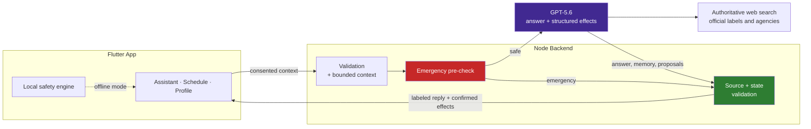
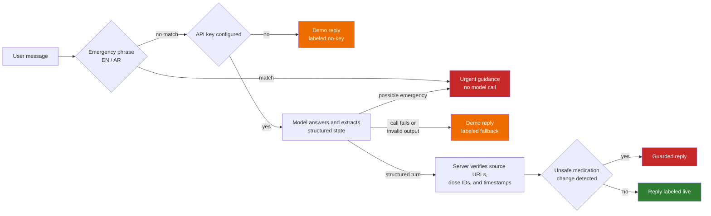

# PillAI

A medication companion that keeps track of what you take, what you eat, and what your body can handle.

[](https://flutter.dev)
[](https://nodejs.org)
[](https://developers.openai.com/api/docs/models/gpt-5.6-terra)
[](LICENSE)

> PillAI is an adherence prototype. It is not medical advice, a diagnostic device, or an autonomous prescriber.

## Why we built it

People juggling several medications a day can get reasonable answers from a regular chatbot. Don't drink tea or milk near iron, the calcium blocks absorption. Space iron a few hours from certain antibiotics.

The problem is living with it. A chat forgets everything between sessions, so the same conditions have to be retyped constantly. Logging a dose means writing a sentence. Miss one dose and the rest of the day falls apart, with no way to fix the schedule short of asking again and hoping the answer is consistent.

PillAI keeps that context permanently and makes logging a single tap. Taken, missed, or snoozed.

## How it works

The assistant answers naturally rather than selecting from a list of canned cases. Each turn produces a strict structured result: the answer, durable facts the user explicitly reported, an optional dose event, optional reminder changes, and retrieved evidence. This is why tea, pregnancy, shift work, fasting, symptoms, and future situations all use the same pipeline instead of separate hardcoded buttons.



The API key lives only on the server. It is never in Flutter, never in `--dart-define`, never in a web build.

### Safety gate order

Emergency detection is deterministic and runs before any network call, so a model cannot talk it down.



Every answer is labeled with where it came from: live, fallback, no-key, or emergency.

## The model inside the product

The assistant originally used an enum-only classifier and fixed replies. That was safe but it could not deliver the central product idea, so it was replaced with a general structured assistant boundary: free conversation on the outside, validated data and proposals on the inside.

The app calls GPT-5.6 Terra through the Responses API with Structured Outputs, `store: false`, bounded recent chat, durable structured memory, and domain-filtered web search. The model can write a useful answer, but it cannot bypass the emergency gate or directly mutate the schedule. The server accepts reminder changes only for existing open doses and only when the cited authoritative URL was actually retrieved in that request.

## Features

- Arabic and English, with a full right-to-left layout, Arabic voice input (`ar_SA`), and an Arabic offline assistant
- Four simple tabs: Today, Assistant, Medicines, Profile. Today shows the next dose with one big "Taken" button, a 7-day strip, and the rest of the day
- Real recurring plans: once to four times a day, or as needed, for a set number of days or ongoing. Medicines, dose history, chats, and consent choices are saved on the device
- First-run onboarding (language, name, one short safety note) and "Delete all my data" in Profile
- Saudi emergency numbers (997, 911, MOH 937) one tap away from the assistant and Profile
- Assistant one tap from the home screen, with text input and review-before-send voice input
- Conflict context covering active ingredients, food and drinks, supplements, pregnancy and breastfeeding, allergies, kidney and liver function, and age
- One-tap dose logging with full schedule history
- Natural-language facts and high-confidence dose reports become structured app state instead of disappearing inside a long chat
- Source-backed reminder changes can reorganize several doses at once, but always wait for one-tap user confirmation
- Standard and Simple layouts, the second with larger type for older users, usable at 200% text scale
- Emergency phrases in English and Arabic handled locally before any model call
- Explicit consent before health context leaves the device

Everything is kept in one local snapshot (`lib/domain/app_store.dart`, `lib/data/preferences_state_storage.dart`): medicines and their schedules, dose history, the safety profile, AI-extracted memory, the last 40 chat messages, and the smart-answers consent. It is not encrypted yet; move it to encrypted storage before a public release. PillAI never stores raw microphone audio, though the device speech service may process it online.

## Running it

You need Flutter on your `PATH`, and Node.js 18+ for the backend.

### Local only, no server

```powershell
flutter pub get
flutter run --dart-define=PILLAI_API_BASE_URL=off --dart-define=PILLAI_TIME_ZONE=Asia/Riyadh
```

Nothing leaves the device. The deterministic assistant and the rest of the app stay usable.

### With the backend

Create the server environment file once:

```powershell
cd server
Copy-Item .env.example .env
```

Keep `OPENAI_API_KEY` only in `server/.env`. Add a random
`PILLAI_SAFETY_ID_SECRET` containing at least 32 characters. The server loads
this file automatically; variables supplied by a production host or the shell
still take priority.

Terminal 1, start the server:

```powershell
cd server
npm install
node src\index.js
```

Terminal 2, the app:

```powershell
flutter pub get
flutter run -d chrome --dart-define=PILLAI_API_BASE_URL=http://127.0.0.1:8787 --dart-define=PILLAI_TIME_ZONE=Asia/Riyadh
```

On an Android emulator use the host-loopback address `http://10.0.2.2:8787` instead.

Check that it actually went live. `GET /health` reports `"mode":"demo"` without a key and `"mode":"model"` with one:

```powershell
curl http://127.0.0.1:8787/health
```

`PILLAI_SAFETY_ID_SECRET` is required alongside a key, and the server refuses to start on a weak one. An invalid key degrades back to demo rather than crashing, so check `/health` before trusting that a reply is live.

Terra remains the default balanced model for the conversational, extraction, and evidence-grounding workload. `gpt-5.6-luna` is cheaper and needs no code change, just a different `PILLAI_OPENAI_MODEL`; evaluate it on real multilingual medication conversations before using it in production.

If `/health` says `"mode":"model"` but replies show a degraded fallback,
the key was loaded and the upstream request failed. A 429
`insufficient_quota` response means the OpenAI API project needs available
credits and compatible organization/project spend limits before live replies
can resume.

## Verify

```powershell
flutter analyze
flutter test
flutter build web
flutter build apk --debug
```

```powershell
cd server
node --test
```

Design review screenshots of every screen, in both languages:

```powershell
flutter test test_screenshots
```

They are written to `build/screenshots/ar` and `build/screenshots/en`.

## Layout

```text
lib/
  app.dart                  App shell, dependency wiring, navigation
  data/                     Fixtures, HTTP/voice adapters, safety options
  domain/                   Models, state, gateways, local safety engine
  presentation/l10n/        Every UI string, English and Arabic side by side
  presentation/screens/     Today, assistant, medicines, profile, onboarding
  presentation/theme/       Color, type, spacing, accessibility tokens
  presentation/widgets/     Reusable cards, buttons, glyphs, brand mark
server/
  src/                      Validated assistant API and OpenAI adapter
  test/                     Contract, safety, validation, and HTTP tests
docs/                       Architecture notes
```

See [PRODUCT_ARCHITECTURE.md](docs/PRODUCT_ARCHITECTURE.md) for the model and tool boundary.

## Safety boundary

PillAI can retrieve current official labels and public-health sources, but web retrieval is not a complete clinical interaction database and cannot prove that a combination is safe. Missing evidence is reported as missing evidence, never converted into an all-clear.

The model handles broad language understanding and creates typed proposals. Emergency gates, strict schemas, source allowlisting, retrieved-URL checks, existing-dose checks, and confirmation keep model text from changing a medication plan directly. Prescribed dose, frequency, route, and course length are never changed automatically.

Do not deploy this prototype publicly. It has no authentication, rate limiting, production TLS, durable audit storage, or multi-user isolation. CORS is a browser boundary, not authentication.

Set `PILLAI_SCHEDULE_PROPOSALS=false` on the server to run as a medication organizer (no AI-proposed reminder moves) until SFDA confirms the classification.

## What's next

- Phone notifications for each reminder (the plan is saved, but the phone does not ring yet)
- Encrypted local storage and cloud backup
- A verified clinical database so interaction claims can cite a versioned source
- Refill tracking
- Authentication and multi-user isolation

- A shared answer store so repeat questions do not each cost a model call. The hard part is that answers cannot be keyed on question text alone, since pregnancy, organ function, and allergies change the correct response, so the reusable layer is the clinical facts rather than the composed reply

## License

[MIT](LICENSE)
